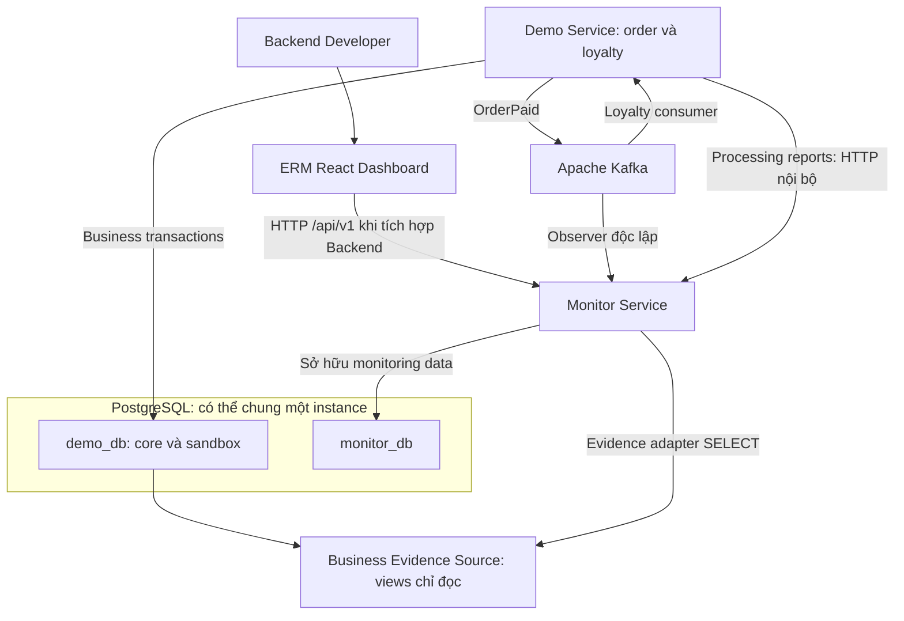
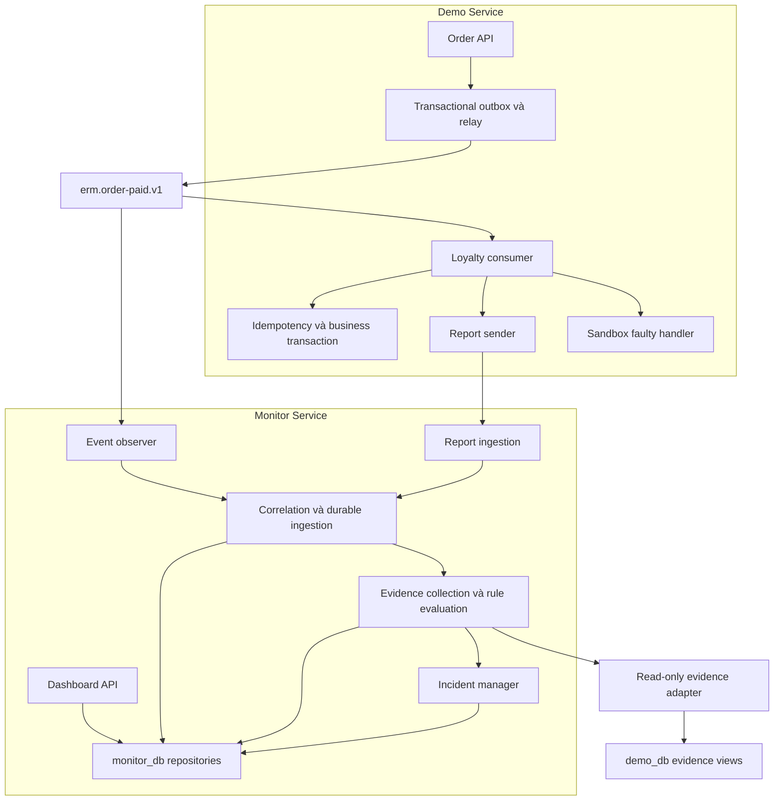
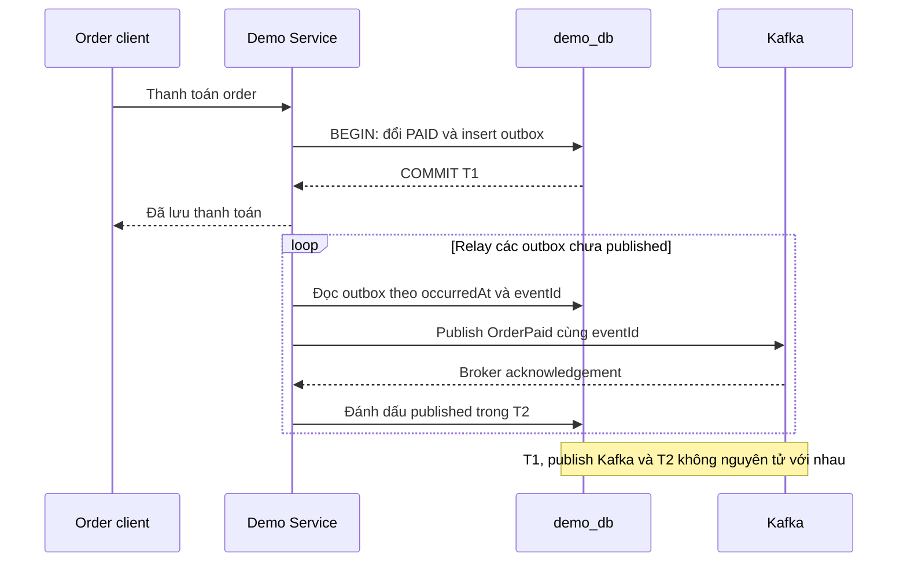
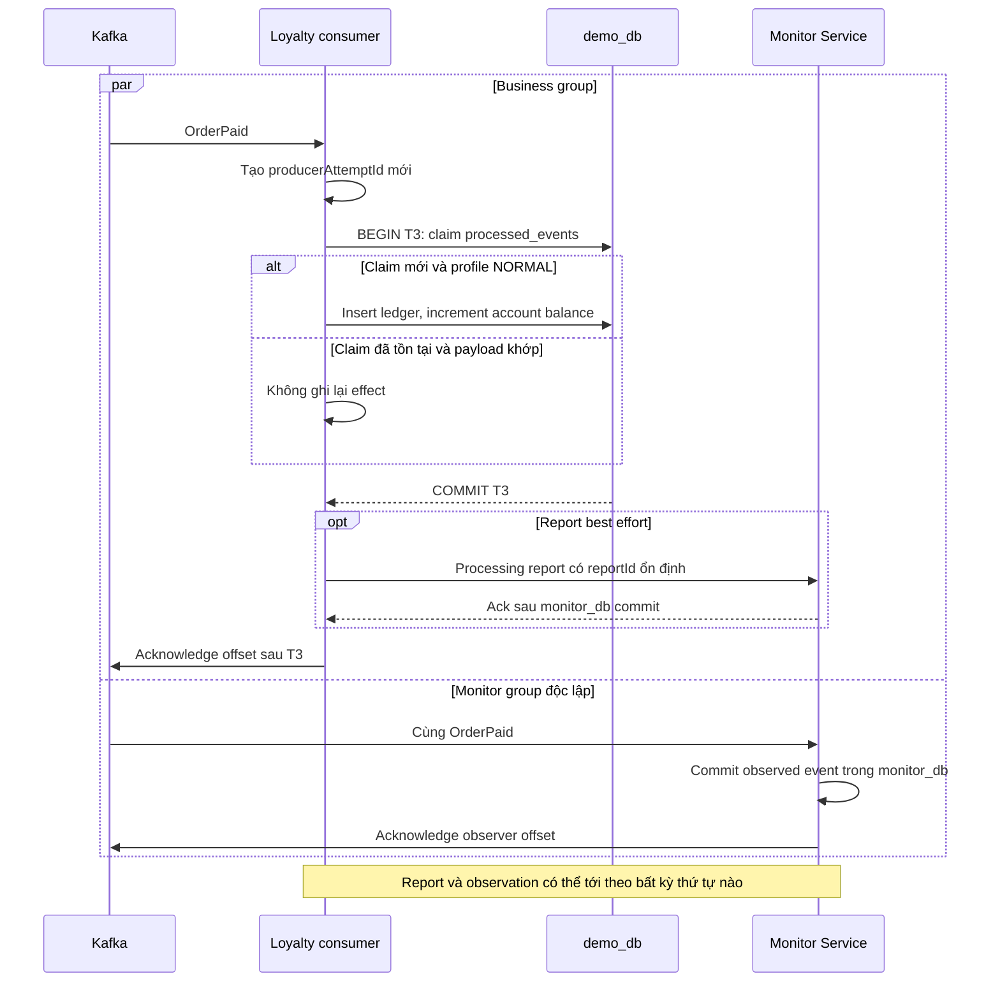
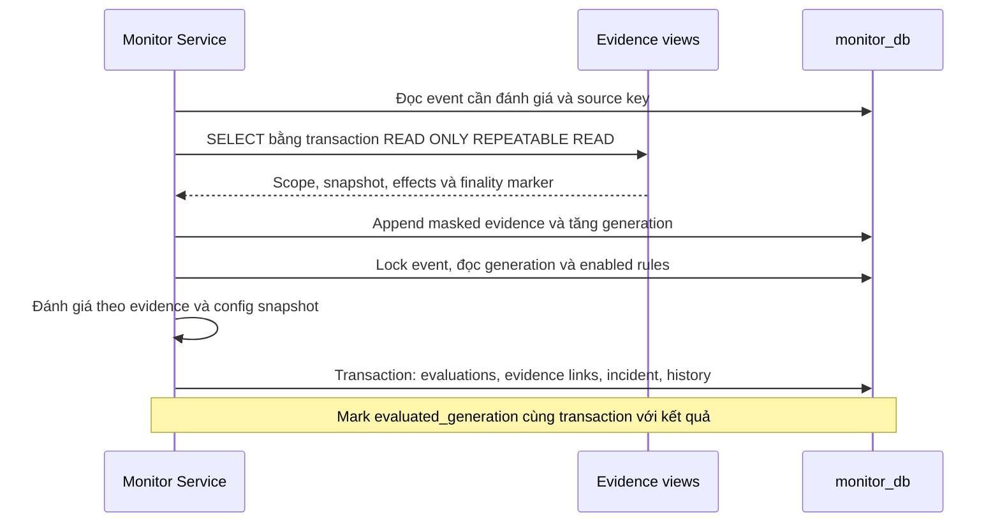
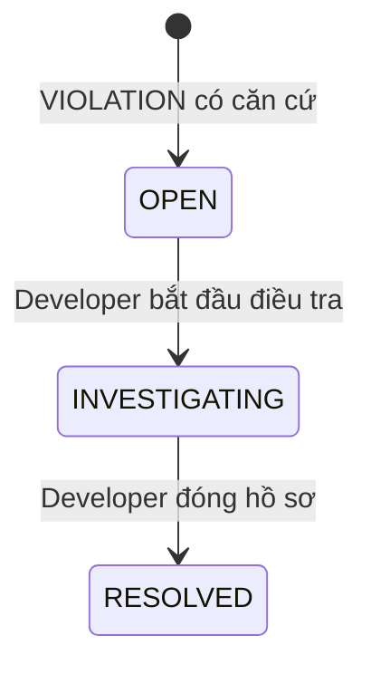

# ERM — Architecture

## 1. Phạm vi và trạng thái

Tài liệu thiết kế kiến trúc mục tiêu cho Event Reliability Monitor, dựa trên [Product Scope](01-product-scope.md), [Use Cases](02-use-cases.md), [Demo Scenarios](03-demo-scenarios.md), [Screen Requirements](03a-screen-requirements.md) và [Traceability](03b-traceability.md). Cấu trúc dữ liệu tương ứng ở [Data Model](05-data-model.md).

**Trạng thái:** thiết kế, chưa có implementation hoặc kiểm thử runtime. Dashboard prototype dùng mock adapter; Backend, Kafka, PostgreSQL và evidence adapter bên dưới là kiến trúc triển khai về sau. Cổng local dự kiến: dashboard `5173`, Demo Service `8080`, Monitor Service `8081`. Phiên bản nền: Java 21, Spring Boot, React + TypeScript + Vite; phiên bản dependency cụ thể được khóa khi triển khai tương ứng.

ERM quan sát và giải thích bằng chứng. Consumer chịu trách nhiệm idempotency; Monitor không repair, replay production hoặc ghi vào business database.

## 2. System context và ownership

| Ranh giới | Sở hữu và trách nhiệm | Không thực hiện |
|---|---|---|
| Demo Application | Một Spring Boot service gồm Order API, outbox relay, Loyalty consumer và module fault-injection chỉ ở sandbox | Không sửa rule/evaluation/incident của Monitor |
| Monitoring System | Một Spring Boot service gồm observer, report ingestion, evidence adapter, rule evaluator, incident manager và Dashboard API | Không sửa order, account, ledger hoặc offset của Loyalty consumer |
| PostgreSQL | Hai databases logic `demo_db` và `monitor_db`; schema `sandbox` cô lập trong `demo_db` | Không có FK xuyên databases hoặc transaction nguyên tử bao trùm Kafka |
| Dashboard | Mock adapter trong prototype; HTTP adapter cùng abstraction khi tích hợp API | Không sử dụng thông tin ngoài phạm vi bằng chứng mà hệ thống quan sát được; không gọi trực tiếp DB hoặc Kafka |

Business Evidence Source là các views của dữ liệu nghiệp vụ, không phải service triển khai thứ ba. Evidence adapter là module trong Monitor, có datasource read-only riêng tới `demo_db`. Credential và topic-to-application mapping thuộc cấu hình triển khai, không nhận qua form Applications hoặc arbitrary URL/SQL từ event.

## 3. Component architecture

| Component | Đầu vào → đầu ra bền vững |
|---|---|
| Order API | Lệnh thanh toán → `orders` và `outbox_events` cùng transaction |
| Outbox relay | Outbox chưa publish → Kafka acknowledgement → đánh dấu published; có thể publish lặp |
| Loyalty consumer | Event envelope hợp lệ → transaction `processed_events` + `loyalty_entries` + `loyalty_accounts`; hoặc route sandbox được allowlist |
| Report sender | Attempt instrumentation → terminal/started report tới Monitor; best effort, có retry ngắn và có thể mất |
| Event observer | Topic OrderPaid ở group riêng → upsert `observed_events`; commit offset sau DB commit |
| Report ingestion | Report hợp lệ → event placeholder nếu cần, attempt, immutable report và evidence snapshot trong `monitor_db` |
| Evidence adapter | Event identity và source key đã cấu hình → snapshot masked hoặc evidence gap; chỉ ghi kết quả vào `monitor_db` |
| Rule evaluator | Event + reports + evidence + config snapshot → append `rule_evaluations` và evidence links |
| Incident manager | Evaluations VIOLATION → một hồ sơ/event và các liên kết; status/history có transaction riêng |
| Dashboard API | Read models từ `monitor_db`, mutation application/rule/incident có validation; không query live ledger theo mỗi page render |

Report ingestion là giao tiếp service-to-service; shape và endpoint cụ thể sẽ thuộc API Contract. Không dùng các endpoint dashboard như đường tắt để giả lập monitoring runtime.

## 4. OQ-01 — Nguồn quan sát event

| Phương án | Ưu điểm | Trade-off và giới hạn |
|---|---|---|
| Consumer Kafka group riêng | Biết event mà không cần processing report; dùng log hiện có; không tranh partition với business group | Bị giới hạn bởi Kafka retention, ACL, uptime và dữ liệu thực sự đã publish |
| Chỉ dựa processing reports | Ít component | Report mất thì không biết event tồn tại; không đáp ứng DS-04/05 |
| Durable audit/outbox feed riêng | Có thể đối soát event chưa publish hoặc vượt retention khi được giữ đủ lâu | Cần thêm ingestion/reconciliation và quyền đọc; chưa cần cho MVP |

**Quyết định OQ-01:** observer Kafka group riêng trong Monitor.

| Cấu hình thiết kế | Giá trị |
|---|---|
| Topic | `erm.order-paid.v1`, không compact trong MVP; giữ event theo retention được cấu hình khi triển khai |
| Message key | `orderId`, để giữ thứ tự trong phạm vi order; không dùng key thay logical event ID |
| Business consumer group | `erm-loyalty-v1` |
| Monitor consumer group | `erm-monitor-observer-v1` |
| Initial position | `earliest` chỉ khi group chưa có committed offset; không phải cơ chế khôi phục dữ liệu đã hết retention |
| Consumer commits | Tắt auto commit; xử lý theo record, DB commit trước acknowledgement; không acknowledge vượt record chưa lưu |
| Correlation | `(applicationId, eventId)`; applicationId phải khớp topic/producer mapping được cấu hình |

Observer lưu envelope chuẩn hóa, source key, envelope hash, Kafka metadata và trạng thái OBSERVED. Upsert có UNIQUE `(application_id, event_id)`. Cùng ID/cùng nội dung bị giao lại chỉ cập nhật metadata quan sát, không tạo event hoặc attempt mới. Giữ metadata đầu/cuối, không hứa lưu toàn bộ lịch sử delivery.

Report có thể đến trước observer: ingestion tạo placeholder `REPORTED_ONLY`, liên kết attempts/reports bằng cùng identity; chỉ Kafka envelope hợp lệ mới nâng thành OBSERVED và cung cấp canonical event fields. Observer đến trước thì report nối vào row có sẵn. Transaction và unique constraint xử lý hai nguồn đến đồng thời; không matching theo timestamp, customer hoặc orderId đơn lẻ.

Cùng identity nhưng envelope bất đồng: giữ canonical envelope đã chấp nhận, lưu evidence `CORRELATION_CONFLICT` và đánh dấu conflict; không ghi đè im lặng. Các rule phụ thuộc dữ liệu xung đột trả UNKNOWN cho đến khi có evidence xác minh phù hợp. Application chưa cấu hình hoặc record không parse được khiến partition pause và ghi lỗi vận hành; không ack/drop như một record hợp lệ.

**Giới hạn:** Monitor không biết mọi event. Order mới có trong outbox nhưng chưa publish chưa phải Kafka-observed event; observer gián đoạn quá retention có thể mất event vĩnh viễn nếu không có report/feed đối soát. Restart dùng committed offsets và DB dedup; retention gap phải công bố qua lỗi/giới hạn vận hành, không đổi thành business FAILED. Backfill/audit feed riêng là khả năng bổ sung về sau, chưa được coi là hiện có.

## 5. OrderPaid, transaction và offset

### 5.1. Publish từ Order API

Payment lặp không phát sinh OrderPaid mới: lock row order, chỉ chuyển CREATED → PAID một lần; outbox UNIQUE `(order_id, event_type)` bảo vệ thêm cho mô hình một lần thanh toán/order. Producer dùng eventId được tạo ở T1 và giữ nguyên khi retry. Outbox có envelope đủ để relay mà không tái tạo ID hoặc đọc trạng thái mới không liên quan.

Relay MVP dùng một worker trong Demo Service, không thêm CDC/Kafka Connect. Chỉ đánh dấu published sau broker ack. Nếu ack thành công nhưng process crash trước T2, relay publish lại cùng eventId; consumer phải dedup. Kafka lỗi giữ row chưa published để retry. Không hứa publish thành công nếu Kafka vĩnh viễn không phục hồi hoặc outbox bị mất. Các lựa chọn:

| Cách publish | Đánh giá |
|---|---|
| Ghi DB rồi publish trực tiếp | Đơn giản nhưng crash sau DB commit có thể làm mất event; không chọn làm đích MVP |
| Transactional outbox + polling | **Chọn**: thêm một bảng/worker, khép khoảng trống mất ý định publish; chấp nhận duplicate delivery và độ trễ polling |
| Đồng bộ Spring DB/Kafka transactions | Không phải atomic commit hai tài nguyên; vẫn có cửa sổ commit một bên rồi lỗi bên kia |
| Outbox + CDC | Khả thi khi cần mở rộng khả năng phát hành sự kiện, nhưng tăng hạ tầng và chi phí vận hành, chưa cần thiết trong phạm vi MVP |

### 5.2. Consume và báo cáo

Nhánh trên là đường NORMAL. Profile fault-injection dùng transaction riêng trong schema sandbox theo §7, không ghi core ledger/account. Report tốt nhất được gửi sau commit nghiệp vụ; report không phải điều kiện để acknowledgement business offset khi T3 đã thành công. Report SUCCEEDED chứng minh ứng dụng báo hoàn tất, không chứng minh invariant.

Database rollback → không ack business offset; gửi FAILED report best effort nếu process còn sống. Crash trước commit → T3 rollback; crash sau commit/trước ack → redelivery nhưng idempotency giữ một effect. Nếu handler gặp lỗi sau T3 đã commit (như DS-02), FAILED report của attempt không được hiểu là ledger rollback; lần sau dedup thành công và gửi SUCCEEDED report.

STARTED report là tùy chọn; terminal report mang lại startedAt nếu biết. Hard crash có thể không để lại report nào. Mỗi lần invocation mới tạo attempt identity mới; retry HTTP của cùng report giữ nguyên reportId/attemptId. Không lấy attempt count từ số Kafka deliveries hoặc số HTTP retries.

### 5.3. Thu evidence và đánh giá

Evidence I/O không giữ lock transaction `monitor_db` trong lúc chờ database khác. Snapshot có thể đến trễ; generation mới buộc worker xem lại đầu vào, không cập nhật đè evaluation cũ. Nếu worker đã dùng generation cũ, lock/check generation trước khi persist để bỏ kết quả stale và tính lại.

## 6. Idempotency, retry và bảo đảm

### 6.1. Transaction nghiệp vụ NORMAL

T3 là một transaction PostgreSQL trong `demo_db`, với thứ tự:

1. Validate envelope, expected points, customer/order và source profile theo cấu hình.
2. `INSERT processed_events ... ON CONFLICT DO NOTHING RETURNING event_id`.
3. Nếu đã có row: kiểm tra envelope hash đã lưu khớp; không increment balance hoặc insert ledger lần nữa. Không dùng check-then-insert bằng SELECT làm hàng rào chống race.
4. Nếu claim mới: insert một `loyalty_entries` với `event_id UNIQUE`, sau đó atomic increment `balance = balance + delta`, `version = version + 1`; account phải tồn tại/được tạo an toàn, số row update phải bằng 1.
5. Commit toàn bộ marker, ledger và balance; bất kỳ lỗi nào rollback toàn transaction. Marker không được commit riêng trước ledger.

Hai concurrent consumers cùng event: UNIQUE/PK serialize cuộc đua claim, một transaction thắng; transaction thua chỉ dedup sau khi thấy kết quả đã commit. Transaction thắng rollback thì transaction khác có thể claim. Hai events khác nhau cùng account dùng atomic increment hoặc row locking, tránh read-modify-write gây lost update. `version` chuẩn bị cho optimistic locking ở các đường ghi khác; không dùng đồng thời hai cơ chế mà bỏ qua affected-row checks.

| Nơi bảo đảm | Bảo đảm cụ thể | Không bảo đảm |
|---|---|---|
| PostgreSQL | Atomic T1/T3, PK/UNIQUE/FK/checks, update balance có khóa row | Không chứng minh handler dùng đúng customer/delta nếu thiếu validation; không nguyên tử với Kafka |
| Ứng dụng | Giữ event identity, validate payload, đúng transaction boundary và ack ordering, read-only/masking | Có bug có thể làm nghiệp vụ sai; cần integration/concurrency tests |
| Kafka | Giao theo group, offset/replay trong retention; producer idempotence giảm duplicate khi gửi lại cùng producer session | Không tự chống duplicate business effect trong PostgreSQL; không biết balance đúng hay report đủ |
| Monitor | Dedup observation/report, lưu evidence và lịch sử giải thích | Không biết các attempts không báo cáo; không chứng minh toàn bộ hệ thống đúng |

### 6.2. Retry tối thiểu

- Business consumer và observer xử lý record theo partition, không chạy async vượt record chưa commit. Lỗi DB transient: thử lại cùng record tối đa 3 lần, backoff dự kiến 1/2/4 giây bằng container-managed backoff/pause duy trì polling hợp lệ. Hết số lần hoặc lỗi validation: pause partition, báo lỗi vận hành, không tự commit record lỗi. Chi tiết cấu hình container cần test cùng phiên bản Spring Kafka sẽ dùng.
- Không thêm retry topic hoặc DLQ trong MVP: pause giữ lại khả năng retry nhưng chặn tiến độ partition; manual recovery thuộc vận hành tương lai. Không silent recovery/skip mặc định rồi tuyên bố event đã xử lý.
- Outbox relay retry định kỳ với exponential backoff cap 30 giây, row pending được giữ bền vững. Một worker ban đầu; nếu thêm worker phải dùng row lease/locking và vẫn chấp nhận publish lặp.
- Report sender retry ngắn với reportId ổn định; không tạo report outbox trong MVP. Report có thể thất lạc để thể hiện đúng ranh giới quan sát. Nếu cần delivery bền vững hơn, report outbox là mở rộng riêng; vẫn không biến report thành business proof.
- Evidence adapter retry bằng lịch `next_evaluation_at` lưu trong DB; thất bại tạo evidence gap và UNKNOWN phù hợp. UI tải API lỗi vẫn là error, không tự render UNKNOWN thay cho lỗi transport.

## 7. OQ-02 — Duplicate effects trong sandbox

| Phương án | Giá trị | Hạn chế |
|---|---|---|
| Faulty ledger riêng trong schema sandbox | Hai effects thật trong PostgreSQL, trace được nguồn và run; không thêm process | Cần schema/role/view riêng, chỉ minh họa lỗi injected |
| Database fault-injection riêng | Isolation mạnh hơn | Thêm database/datasource và provisioning ngoài hai DB cơ bản |
| Evidence fixture/adapter mô phỏng | Rất nhẹ, phù hợp dashboard mock | Không chứng minh đường ghi và truy vấn DB lỗi trong demo Backend |

**Quyết định OQ-02:** chọn `demo_db.sandbox.fault_runs` và `demo_db.sandbox.faulty_loyalty_entries`, tách khỏi `core.loyalty_entries`. Frontend prototype tiếp tục dùng fixture; Backend demo về sau thực sự ghi và đọc faulty ledger này.

- Ledger NORMAL luôn giữ `UNIQUE(event_id)`, `processed_events` và atomic account update. Không ALTER/DROP constraint để bật lỗi.
- Một event chỉ chọn một authoritative evidence source trong envelope hợp lệ: `loyalty-normal-v1` hoặc `loyalty-fault-v1`. Monitor kiểm allowlist theo application/environment. Không union hai ledgers hoặc đếm hai nguồn là hai effects.
- Sandbox handler chỉ bật qua cấu hình local/test, dùng datasource role `fault_writer` riêng. Consumer bình thường không có quyền ghi schema sandbox; Monitor không có quyền ghi cả hai schema. Module faulty không phải service mới, không cung cấp nút inject trên dashboard.
- DS-03 route **chỉ** tới faulty handler: một invocation tạo run `run-ds03` và hai entries `eff-003-1`, `eff-003-2`, cùng logical event `order-paid-1003`, customer và delta +100. Không đồng thời cộng +100 ở normal account. Thao tác ghi hai rows và SEALED marker commit trong cùng sandbox transaction.
- `fault_runs.event_id UNIQUE` dedup redelivery của sandbox run. Faulty entries chỉ UNIQUE effect ID, cố ý cho phép nhiều entries/event trong schema chuyên dụng. SEALED run bất biến; trigger/permission thiết kế ngăn sửa entries hoặc mở lại run đã seal.
- Adapter đọc view sandbox bằng source key đã chốt, lấy hai effect identities, total +200 và SEALED marker. Source label thể hiện **sandbox injected**; không giả đây là corruption xảy ra qua core consumer.

Run SEALED xác nhận dataset fault đã đóng trong phạm vi run, không xác nhận thời điểm consumer hoàn tất. Faulty ledger minh họa hai inserts do một bug trong một attempt; không phải phép thử phá UNIQUE hoặc bằng chứng normal schema có thể ghi trùng. Khả năng rollback/replay, role isolation và sandbox gating vẫn cần kiểm thử khi triển khai Backend.

## 8. Identity và correlation

| Identity | Nguồn | Khóa và ý nghĩa |
|---|---|---|
| Logical event ID | Producer T1 | `eventId`, bất biến khi relay/retry/redelivery; unique trong application |
| Kafka delivery metadata | Broker/consumer | Cluster/topic/partition/offset xác định record vật lý; delivery lặp cùng record không tạo event mới |
| Observation ID | Monitor | `observed_events.id`, ví dụ evt-003; route `/events/:id`; UNIQUE `(application_id,event_id)` |
| Producer attempt ID | Mỗi invocation consumer | ID mới cho một lần xử lý; không đổi khi gửi lại report |
| Attempt record ID | Monitor | `processing_attempts.id`, ví dụ att-003-1; map unique producer attempt trong app |
| Report ID | Instrumentation | Stable producer report ID cho một thông báo; retry HTTP dedup; một attempt có thể có STARTED và terminal reports |
| Business effect ID | Business database | Ledger row ID, ví dụ eff-003-1; khác event ID; source key/run là namespace để đối chiếu |
| Evidence ID | Monitor collector | Immutable snapshot/gap ID, ví dụ ev-003-ledger |
| Evaluation ID | Monitor evaluator | Mỗi kết luận tại một generation/rule version; không thay thế event hoặc report ID |
| Incident ID | Monitor incident manager | Hồ sơ investigation, ví dụ inc-001; nhóm theo observed event |

`correlationId = orderId` hỗ trợ điều tra, không là idempotency key. Customer không đủ phân biệt events. Hai app có eventId giống nhau vẫn là hai events. Runtime IDs có thể là UUID dạng string; fixture IDs có prefix vẫn hợp lệ theo [Data Model](05-data-model.md).

## 9. Evidence và rule semantics

### 9.1. Quy tắc nguồn và completeness

Một evidence snapshot phải lưu: event/application, source key và loại nguồn, query scope/customer/run, observed/collected time, snapshot time nếu có, coverage `COMPLETE/PARTIAL/NONE`, trust `TRUSTED/UNTRUSTED/CONFLICTED`, finality `FINAL/OPEN/UNKNOWN`, masked payload, collector version và digest. Source allowlist và DB role là căn cứ trust trong demo; label tự khai từ report không chứng minh độc lập hoặc trung thực mật mã.

Normal source dùng views order expectation, ledger và processed marker trong một `READ ONLY REPEATABLE READ` transaction. Không LIMIT/paging mất rows. COMPLETE nghĩa đã đọc đủ **nguồn được cấu hình, event/customer và snapshot đó**, không bao trùm DB khác hoặc tương lai. FINAL cần marker processed đã commit cùng ledger/account. Thiếu marker hoặc query chưa xong → OPEN/PARTIAL, không diễn giải zero rows là effect không tồn tại.

Sandbox source cần run SEALED và scope đúng run/event/customer. View cung cấp order expectation + expected +100 độc lập với processing report. Không lấy expected total từ chính ledger để hợp thức hóa kết quả sai. Không dùng `created_at`, processed marker time hoặc snapshot time làm `finishedAt` consumer.

### 9.2. Kết luận theo từng rule

| Rule | PASS | VIOLATION | UNKNOWN |
|---|---|---|---|
| TIMEOUT | Có trusted SUCCEEDED completion và occurredAt canonical; completion sớm nhất trừ occurredAt ≤60 giây | Cùng evidence, độ trễ >60 giây | Thiếu successful finishedAt hoặc occurredAt; clock/provenance/correlation không đáng tin |
| DUPLICATE_BUSINESS_EFFECT | Complete, trusted, final snapshot có ≤1 distinct effect | Trusted evidence chứng minh ≥2 distinct effect IDs cùng event và source scope; lower bound đủ chứng minh dù toàn bộ query chưa complete | Chưa đủ để loại trừ duplicate hoặc evidence conflict |
| DATA_INVARIANT | Complete, trusted, final snapshot; customer/order đúng; sum(delta) = expected points từ order | Cùng scope/quality đầy đủ nhưng sum(delta) khác expected, hoặc có mismatch customer được chứng minh | Thiếu expectation, phạm vi, finality hoặc snapshot đáng tin |

Duplicate PASS với zero effects chỉ chứng minh không nhân đôi trong snapshot; DATA_INVARIANT có thể VIOLATION vì thiếu +100. Hai rule không thay thế nhau. TIMEOUT dùng mốc kết thúc thành công của event, không dùng lần attempt lỗi đầu; DS-02 hoàn tất sau 11 giây. Timestamp âm, clock skew chưa được kiểm soát hoặc report mâu thuẫn → UNKNOWN thay vì số duration giả. Môi trường demo giả định các đồng hồ được đồng bộ; ngưỡng sai lệch đồng hồ và SLO cho production chưa được đo lường.

Quá 60 giây nhưng không successful report → timeout candidate, TIMEOUT UNKNOWN; không tự mở incident confirmed timeout. Ledger độc lập có thể cho business PASS/VIOLATION khi timeline vẫn thiếu. Processing status là projection từ reports, không từ rule outcome: có trusted success → CONFIRMED; chỉ có latest failure → FAILED theo reports hiện thấy; chỉ có STARTED → PENDING; không report phù hợp → UNKNOWN. FAILED không chứng minh không effect hoặc không có retry chưa được báo.

### 9.3. Late data, conflict và history

Evidence và reports được append, không sửa snapshot đã dùng. Report đến trễ được dedup theo report identity; mới thật sự tăng event generation. Worker dựa trên durable `evaluation_generation`, `evaluated_generation`, `next_evaluation_at`; khi restart vẫn quét được việc chưa làm. Đánh giá một generation/rule version chỉ ghi một lần; transaction viết evaluation, evidence links, incident links và checkpoint cùng nhau.

Evidence mới có thể supersede snapshot cũ, nhưng không xóa nó. Chọn snapshot mới nhất **hợp lệ trong source scope** tại evaluation cutoff; không chọn PASS vì thuận ý. Hai nguồn không reconcile hoặc hai reports cùng attempt có terminal result xung đột → conflict evidence; rule phụ thuộc thông tin đó UNKNOWN. Snapshot độc lập vẫn có thể hỗ trợ rule không phụ thuộc phần conflict. Khác kết quả giữa các snapshot ở các thời điểm khác nhau không tự là conflict; cần xét finality và thứ tự.

Mọi evaluation lưu reason, config snapshot/version, evaluator version, input generation, evaluatedAt và evidence IDs. UNKNOWN có reason code/gap; không dùng HTTP error/null để thay outcome. UI mặc định đọc latest evaluation từng rule và có lịch sử; số UNKNOWN ở Overview đếm latest evaluations trong phạm vi, không cộng tất cả historical revisions.

Toggle rule chỉ đổi configuration cho đánh giá mới, không xóa hay recompute history. Trong mock, toggle không chạy engine và dữ liệu reset khi reload. Runtime worker tôn trọng enabled cho việc mới; bật lại không tự chạy hàng loạt historical backfill.

## 10. Incident policy

**Grouping:** một incident cho một observed event, khóa UNIQUE `observed_event_id`; application đã nằm trong identity của event. Mọi rule VIOLATION của event được nối vào cùng incident bằng bảng nhiều-nhiều. UNKNOWN/PASS không tự tạo incident; timeout candidate không tạo incident nghiệp vụ.

Primary rule chọn ở batch tạo case theo ưu tiên `DUPLICATE_BUSINESS_EFFECT > DATA_INVARIANT > TIMEOUT`, rồi rule ID để tie-break; giữ primary sau khi tạo. DS-03 có một `inc-001`, primary rule-002, liên kết cả duplicate và invariant evaluations. Severity HIGH cho duplicate/invariant, MEDIUM cho timeout đã chứng minh; lấy severity cao nhất khi tạo, chỉ nâng nếu có vi phạm mới nặng hơn và ghi history.

Mỗi transition hợp lệ lock/version-check incident, update status/timestamps và append history cùng transaction. Không OPEN → RESOLVED, không reopen/đổi ngược trong workflow này. Retry cùng trạng thái không tạo history mới; concurrent transition phải có một kết quả nhất quán.

Late VIOLATION nối vào case có sẵn, kể cả đã RESOLVED, kèm history EVIDENCE_ADDED; không tự reopen, xóa resolvedAt hoặc sửa ledger. Late PASS/UNKNOWN không xóa VIOLATION links hoặc tự resolve. UI có thể xem latest evaluations trên event song song với bằng chứng lịch sử khi incident mở. Chính sách một case/event đánh đổi khả năng mở investigation mới cho lần tái diễn; chấp nhận vì logical event bất biến trong MVP, không có recurring incidents/reopen.

## 11. Failure modes

| Failure mode | Nguyên nhân | Tác động | Còn quan sát được | Kết luận được phép | Phục hồi/giới hạn |
|---|---|---|---|---|---|
| Crash trước T3 commit | Process chết/lỗi DB | Rollback marker/ledger/balance | Observer event, có thể STARTED report | Chưa đủ proof effect; không kết luận thành công từ offset | Redelivery, xử lý lại |
| Crash sau T3 commit/trước ack | Commit xong rồi chết | Event được giao lại | Event và independent ledger; terminal report có thể mất | Business rules theo evidence, attempts thực tế có thể chưa đủ | UNIQUE dedup, không cộng lần nữa |
| Event redelivery | Ack/publish retry | Nhiều invocations hoặc deliveries | Một logical event, các reports có sẵn | Không suy duplicate effect từ attempts | Dedup DB và report ID |
| Processing report thất lạc | Network/process/best effort | Thiếu timeline | Observer event; independent ledger nếu truy vấn được | DS-04 UNKNOWN; DS-05 business PASS, TIMEOUT UNKNOWN | Không fabricate report; delivery bền vững hơn là mở rộng |
| Observer không nhận event | Pause, ACL, quá retention | Chưa có OBSERVED row | Có thể report placeholder REPORTED_ONLY | Không khẳng định biết mọi event | Retry trong retention; vượt retention cần feed/backfill riêng |
| Kafka unavailable | Broker/network | Outbox pending, consumers thiếu event mới | Order/outbox trong Demo DB, dữ liệu Monitor cũ | Không suy payment fail hoặc event xử lý fail | Relay retry; không bảo đảm nếu outage vĩnh viễn |
| Adapter không truy cập DB | Role/network/query lỗi | Không có snapshot mới | Event/reports và evidence gap/cũ | Rule phụ thuộc evidence mới có thể UNKNOWN; snapshot cũ chỉ là lịch sử | Retry scheduled; không render snapshot cũ như hiện tại |
| Evidence chưa đầy đủ | Chưa final, phân trang, partial source | Không đủ để PASS business rule | Scope, partial rows, finality gap | UNKNOWN; ≥2 trusted distinct effects vẫn đủ duplicate VIOLATION | Query lại đúng scope; không coi thiếu rows là zero effects |
| Duplicate business effect | Faulty handler tạo hai entries | +200 so với +100 | Sandbox ledger đầy đủ, report có thể success | Duplicate/invariant VIOLATION; một incident/event | Con người điều tra; Monitor không repair |
| Monitor restart | Process chết | Công việc in-memory mất | Observations/reports/evidence/generations/incident DB | Chỉ kết luận từ dữ liệu đã lưu | Quét pending generations, resume offsets; DB mất cần restore riêng |
| Identity/payload conflict | Producer bug hoặc report sai | Correlation không đáng tin | Canonical envelope và conflict evidence | UNKNOWN cho rule chịu ảnh hưởng | Không merge/overwrite im lặng; điều tra nguồn |

## 12. Mapping scenarios và giao diện

| Scenario | Đường nghiệp vụ/evidence | Processing | TIMEOUT / DUPLICATE / INVARIANT | Incident |
|---|---|---|---|---|
| DS-01 | NORMAL, một effect +100, complete final snapshot, một terminal report | CONFIRMED | PASS / PASS / PASS | Không |
| DS-02 | NORMAL, hai attempts có report, một effect +100 | CONFIRMED | PASS / PASS / PASS | Không |
| DS-03 | Faulty run SEALED, hai effects +100, một success report | CONFIRMED | PASS / VIOLATION / VIOLATION | inc-001, HIGH, primary rule-002 |
| DS-04 | Observer event, report mất, adapter gap | UNKNOWN | UNKNOWN / UNKNOWN / UNKNOWN | Không; timeout candidate |
| DS-05 | Observer event, report mất, normal complete final ledger | UNKNOWN | UNKNOWN / PASS / PASS | Không |

Baseline snapshot `2026-10-17T10:10:00Z`: 5 OBSERVED events, 3 confirmed processing signals, 1 open incident, 15 latest evaluations = 9 PASS + 2 VIOLATION + 4 UNKNOWN. Bốn terminal reports đã ghi nhận tạo bốn attempts có thể quan sát; các attempts/effects thực tế nhưng chưa được xác minh của DS-04/05 không xuất hiện trong read model. Full fixture ≥30 events/≥2 applications/≥5 incidents được đặc tả riêng; không giữ số seed làm thống kê toàn dataset.

Các quyết định OQ-01/OQ-02 và incident grouping cụ thể hóa những vấn đề được xác định trong tài liệu yêu cầu và cung cấp cơ sở cho thiết kế API. API Contract cần chốt DTO/validation/filter/pagination, report ingestion envelope, aggregate display và biểu diễn provenance/gaps. Các topic/group, ownership, idempotency key, fault isolation và grouping đã được xác định tại tài liệu này.

## 13. Tài liệu tham chiếu kỹ thuật

- [Apache Kafka: Design / delivery semantics](https://kafka.apache.org/41/design/design/) — dùng cho giới hạn consumer offsets và ghi tới external storage; không là cam kết phiên bản broker sẽ cài.
- [Spring for Apache Kafka: Transactions](https://docs.spring.io/spring-kafka/reference/kafka/transactions.html) — commit DB/Kafka được đồng bộ không loại bỏ cửa sổ lỗi giữa hai commits.
- [Spring: Outbox pattern strategies](https://spring.io/blog/2023/10/24/a-use-case-for-transactions-adapting-to-transactional-outbox-pattern/) — ý định publish được lưu cùng business transaction; relay là bước riêng.
- [PostgreSQL: Constraints](https://www.postgresql.org/docs/current/ddl-constraints.html) và [Transaction Isolation](https://www.postgresql.org/docs/current/transaction-iso.html) — cơ sở thiết kế uniqueness, concurrency và consistent evidence snapshot.

Các chính sách source key, grouping, finality và rule ở trên là lựa chọn của ERM; tài liệu nền không tự bảo đảm implementation đáp ứng chúng. Cần integration tests cho crash windows, concurrent duplicate handling, read-only privileges, report loss và retention gaps trước khi tuyên bố monitoring runtime hoạt động.
