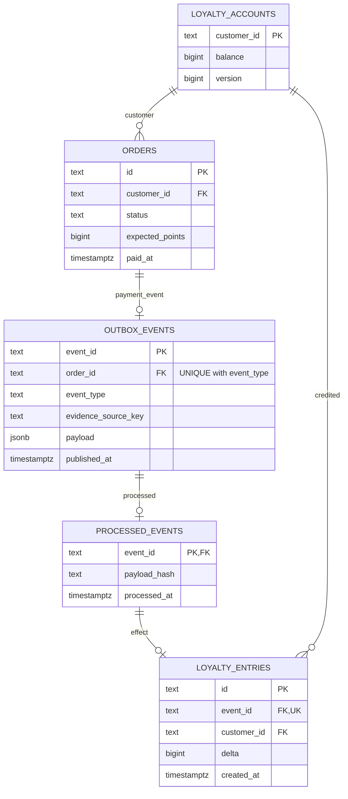
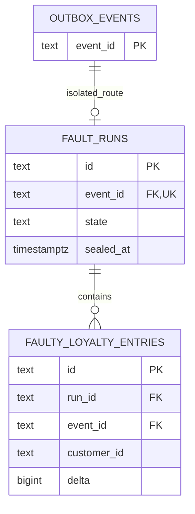
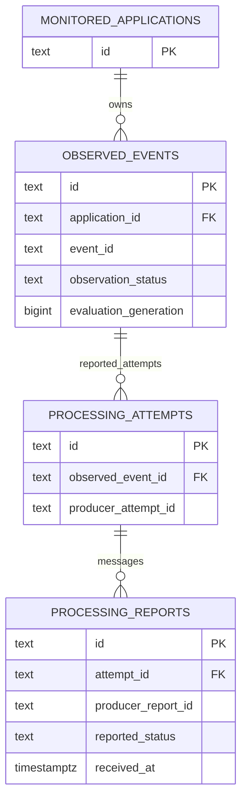
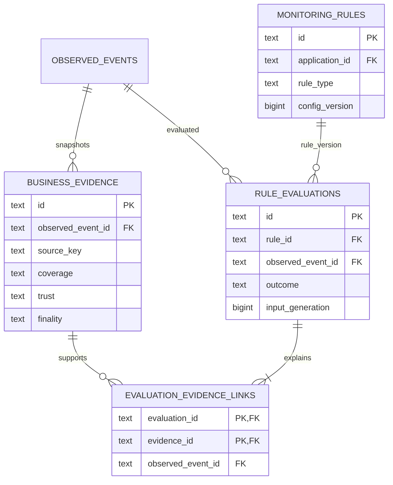
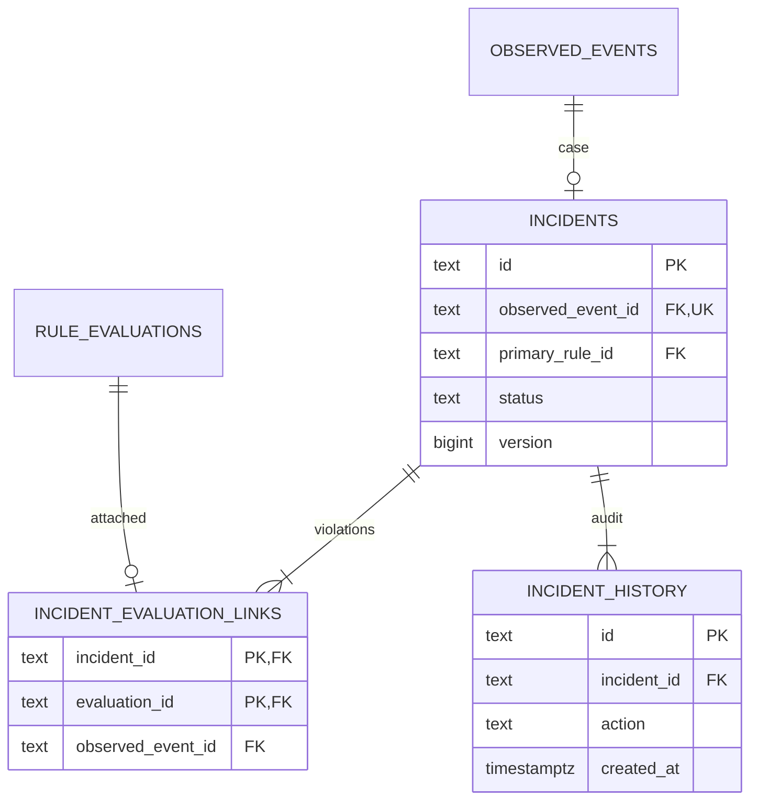

# ERM — PostgreSQL Data Model

## 1. Phạm vi và quy ước

Đây là mô hình dữ liệu **dự kiến**, đi cùng [Architecture](04-architecture.md). Chưa có migrations, database runtime hoặc kết quả concurrency/integration tests. Mô hình hỗ trợ [Use Cases](02-use-cases.md), [năm scenarios](03-demo-scenarios.md) và [yêu cầu màn hình](03a-screen-requirements.md); không thay đổi Product Scope hoặc baseline fixtures.

- Một PostgreSQL instance có hai databases logic: `demo_db` và `monitor_db`. Không tạo FK hoặc transaction xuyên databases. FK trong cùng database, kể cả khác schema, được ghi rõ bên dưới.
- ID nghiệp vụ và ID Monitor dùng `text`, không rỗng, giới hạn 128 ký tự ở validation; runtime có thể sinh UUID dạng string. Chấp nhận các fixture IDs `app-001`, `evt-003`, `att-003-1`, `inc-001` mà không giả chúng là PostgreSQL UUID.
- Thời gian dùng `timestamptz`, serialize ISO 8601 UTC. Duration tính khi hai mốc có căn cứ, không thay null bằng epoch/now. Timestamps của instrumentation có thể thiếu; ingestion time không thay consumer finishedAt.
- Số points dùng `bigint`, integer arithmetic, không dùng float. `version`/generation dùng `bigint` không âm. JSON dùng `jsonb` và CHECK kiểu object; schema nội dung do application validate theo version.
- Trạng thái dùng `text` với CHECK theo domain; không dùng chung enum cho observation, processing, evaluation và incident. NN = NOT NULL; N = nullable. Không hard-delete dữ liệu đã có evidence/evaluation trong MVP; FK mặc định RESTRICT.
- Các bảng bên dưới đều được chọn vào thiết kế. Các cột được gộp trong một hàng có cùng type/nullability. Index từ PK/UNIQUE không tạo lại dưới tên khác.

## 2. Ownership và quyền truy cập

| Database/schema | Owner | Quyền dự kiến |
|---|---|---|
| `demo_db.core` | Demo Service, datasource `demo_writer` | DML orders/accounts/outbox/processed/normal ledger; không ghi sandbox |
| `demo_db.sandbox` | Fault-injection module, datasource `fault_writer` chỉ local/test | Ghi fault run và faulty entries; đọc core outbox/order theo quyền tối thiểu; không ghi normal ledger/account |
| `demo_db.evidence` | Views triển khai bởi migration owner | SELECT order expectation, processed marker, ledger, sealed fault run; không expose PII hoặc credentials |
| `monitor_db.public` | Monitor Service, datasource `monitor_writer` | Ghi monitoring entities; không có quyền business DML |
| Read-only datasource của Monitor | Role `evidence_reader` tại `demo_db` | CONNECT, USAGE schema evidence, SELECT các views cho phép; REVOKE base-table writes/schema CREATE; transaction READ ONLY |

View NORMAL gồm order identity/customer reference/expected points, processed marker và toàn bộ entries cho event. View FAULT gồm expectation từ order, run state và faulty entries cùng run. View không có write rules/triggers. Credentials nằm ngoài tables public/API. Direct database view coupling được chấp nhận cho MVP; đổi sang evidence HTTP adapter vẫn phải giữ source/scope/finality semantics.

`core` và `sandbox` nằm cùng `demo_db`, nên FK fault run → outbox là FK PostgreSQL nội bộ hợp lệ. Tất cả liên kết business ↔ Monitor chỉ là application/event/source references, **không** là FK sang `demo_db`.

## 3. ERD

### 3.1. Business core

Trong phạm vi chỉ OrderPaid, mỗi order có tối đa một outbox payment event. Constraint đầy đủ là UNIQUE `(order_id,event_type)`; không khẳng định order không bao giờ có loại event khác khi mở rộng sản phẩm.

### 3.2. Fault sandbox

Không có UNIQUE(event_id) trên **faulty** entries; constraint ấy luôn tồn tại trên **core** entries. Effect identity duy nhất là PK entry, không phải số row reports.

### 3.3. Observation và reporting

### 3.4. Evidence và evaluation

Mỗi evaluation cần ít nhất một evidence link, kể cả gap evidence cho UNKNOWN. Cardinality tối thiểu này được kiểm bởi transaction evaluator; FK đơn thuần không ép parent có child.

### 3.5. Incident và history

Incident có FK tới application và primary rule, đã mô tả ở table definitions; không vẽ lại tất cả application edges để giữ ERD đọc được. Một evaluation vi phạm chỉ thuộc tối đa một case vì mỗi event chỉ có một case.

## 4. Business tables — `demo_db.core`

### 4.1. `loyalty_accounts`

Account balance materialized để thể hiện transaction/concurrency; ledger giữ từng effect.

| Cột | Type | Null | Ràng buộc/ý nghĩa |
|---|---|---|---|
| customer_id | text | NN | PK, customer reference giả lập trong demo |
| balance | bigint | NN | DEFAULT 0, CHECK ≥0 trong phạm vi chỉ credit |
| version | bigint | NN | DEFAULT 0, CHECK ≥0; tăng cùng update balance |
| updated_at | timestamptz | NN | Thời điểm ghi account gần nhất |

PK index phục vụ account lookup/update. Tạo account trước order hoặc upsert account an toàn trong transaction tạo order; không để consumer update zero rows rồi vẫn commit marker. Account balance không dùng làm thay thế event-scoped evidence vì một customer có nhiều orders.

### 4.2. `orders`

| Cột | Type | Null | Ràng buộc/ý nghĩa |
|---|---|---|---|
| id | text | NN | PK |
| customer_id | text | NN | FK → loyalty_accounts.customer_id |
| status | text | NN | CHECK CREATED/PAID |
| expected_points | bigint | NN | CHECK >0; immutable sau PAID; seed =100 |
| paid_at | timestamptz | N | NN khi PAID; null khi CREATED |
| created_at | timestamptz | NN | Order creation |

CHECK cặp status/paid_at phải mô tả rõ hai nhánh có/không timestamp, không để SQL NULL làm lọt constraint. Index `(customer_id,created_at DESC,id)` phục vụ lấy expectation/đối soát order theo customer trong demo. Order không có UI CRUD ngoài phạm vi ERM dashboard.

### 4.3. `outbox_events`

Outbox row cũng là durable logical event envelope; không tạo thêm bảng events nghiệp vụ có cùng trách nhiệm.

| Cột | Type | Null | Ràng buộc/ý nghĩa |
|---|---|---|---|
| event_id | text | NN | PK; logical event ID giữ nguyên khi republish |
| order_id | text | NN | FK → orders.id; UNIQUE(order_id,event_type) |
| event_type | text | NN | CHECK ORDER_PAID trong MVP |
| application_id | text | NN | App identity cấu hình; logical reference, không FK monitor_db |
| evidence_source_key | text | NN | CHECK loyalty-normal-v1/loyalty-fault-v1; route allowlist theo environment |
| occurred_at | timestamptz | NN | Bằng paid_at khi tạo OrderPaid |
| payload | jsonb | NN | Object versioned gồm eventId/app/order/customer/expected points; không secrets |
| payload_hash | text | NN | SHA-256 canonical immutable envelope, 64 hex |
| published_at | timestamptz | N | Chỉ ghi sau Kafka acknowledgement |
| publish_attempts | integer | NN | DEFAULT 0, CHECK ≥0; delivery telemetry, không consumer attempts |
| next_publish_at | timestamptz | NN | Durable relay retry schedule |
| last_error_code | text | N | Code an toàn, không raw credential/connection string |

Partial index `(next_publish_at,occurred_at,event_id) WHERE published_at IS NULL` cho relay. Không đặt UNIQUE(topic,partition,offset) ở đây vì record vật lý chưa tồn tại khi T1 commit. Outbox payload không sửa sau insert; delivery fields là mutable riêng. Một worker polling; scale-out cần lease/locking thiết kế thêm, không mặc nhiên an toàn với nhiều relay workers.

### 4.4. `processed_events`

| Cột | Type | Null | Ràng buộc/ý nghĩa |
|---|---|---|---|
| event_id | text | NN | PK, FK → outbox_events.event_id |
| payload_hash | text | NN | Immutable envelope hash đã xử lý |
| processed_at | timestamptz | NN | Marker transaction; không là finishedAt attempt |

PK là idempotency claim trong T3; không bảng riêng lưu distributed lock. Marker và ledger/account commit cùng transaction. FK đến outbox phù hợp Demo Service vừa là producer vừa là consumer của orders của chính nó; nếu mở sang external event producer, phải thay thiết kế boundary này bằng event registry phù hợp, không giả FK vẫn dùng được.

### 4.5. `loyalty_entries`

| Cột | Type | Null | Ràng buộc/ý nghĩa |
|---|---|---|---|
| id | text | NN | PK, business effect ID |
| event_id | text | NN | FK → processed_events.event_id, **UNIQUE(event_id)** |
| customer_id | text | NN | FK → loyalty_accounts.customer_id |
| delta | bigint | NN | CHECK >0, expected amount kiểm bằng application/evidence rule |
| created_at | timestamptz | NN | Ledger insert time, không chứng minh attempt hoàn tất |

Index `(customer_id,created_at,id)` phục vụ ledger theo account. UNIQUE event index đủ cho evidence lookup. Bảng append-only; correction/refund ledger ngoài phạm vi hiện tại. FK/checks bảo vệ existence/range; việc customer/delta đúng với order phải được validate ở T3 và kiểm độc lập qua evidence, không tuyên bố UNIQUE tự bảo đảm nghiệp vụ đúng.

## 5. Sandbox tables — `demo_db.sandbox`

### 5.1. `fault_runs`

| Cột | Type | Null | Ràng buộc/ý nghĩa |
|---|---|---|---|
| id | text | NN | PK, ví dụ run-ds03 |
| event_id | text | NN | FK → core.outbox_events.event_id; UNIQUE(event_id) |
| state | text | NN | CHECK PREPARING/SEALED |
| created_at | timestamptz | NN | Thời điểm tạo run |
| sealed_at | timestamptz | N | NN khi SEALED; null khi PREPARING |

Thêm UNIQUE `(id,event_id)` để composite FK entries không liên kết nhầm event/run. Application xác thực outbox profile là fault và environment được phép; FK không tự kiểm điều này. SEALED là finality của bộ dữ liệu sandbox, không là successful processing report.

### 5.2. `faulty_loyalty_entries`

| Cột | Type | Null | Ràng buộc/ý nghĩa |
|---|---|---|---|
| id | text | NN | PK, ví dụ eff-003-1 và eff-003-2 |
| run_id, event_id | text | NN | Composite FK(run_id,event_id) → fault_runs(id,event_id) |
| customer_id | text | NN | Customer reference kiểm với order expectation; không ghi account core |
| delta | bigint | NN | CHECK >0, seed +100 cho mỗi row |
| created_at | timestamptz | NN | Sandbox ledger insert time |

Index `(run_id,event_id,id)` cho snapshot. **Không** có UNIQUE(event_id) tại bảng này; không thay đổi UNIQUE trên core.loyalty_entries. Một sandbox transaction tạo run PREPARING, hai effects và chuyển SEALED trước commit. Redelivery tìm run SEALED hiện có và không tạo run/effects mới. FK run-event + row locking/UNIQUE event bảo vệ concurrent run creation.

Finality enforcement cần trigger từ chối INSERT/UPDATE/DELETE entries thuộc run SEALED và từ chối thay state SEALED về PREPARING; transition seal khóa row run, writer entry cũng khóa row run trước kiểm state. Như vậy không có race insert đồng thời với seal. Chỉ migration owner có DDL; fault_writer không thể bỏ trigger. Đây là yêu cầu migration tương lai, chưa phải constraint đã chạy. Dữ liệu lỗi cô lập không phản ánh normal balance hoặc normal ledger.

## 6. Monitor tables — identity và reporting

### 6.1. `monitored_applications`

| Cột | Type | Null | Ràng buộc/ý nghĩa |
|---|---|---|---|
| id | text | NN | PK, app-001 |
| name | text | NN | Trim không rỗng; duplicate display name được phép |
| environment | text | NN | CHECK SANDBOX/DEVELOPMENT; API có thể biểu diễn labels khác theo mapping rõ |
| status | text | NN | CHECK ACTIVE/INACTIVE, trạng thái cấu hình, không là connectivity health |
| created_at | timestamptz | NN | Creation |

Index `(created_at,id)` nếu danh sách tăng; seed nhỏ có thể sequential scan. Tạo application qua dashboard không tự cấu hình Kafka subscriptions, source credentials hoặc phát sinh events. Binding app-topic/source là cấu hình vận hành allowlist, không bảng secret hoặc form production connection.

### 6.2. `observed_events`

| Cột | Type | Null | Ràng buộc/ý nghĩa |
|---|---|---|---|
| id | text | NN | PK, observed record ID cho routes |
| application_id | text | NN | FK → monitored_applications.id |
| event_id | text | NN | Logical event ID; UNIQUE(application_id,event_id) |
| observation_status | text | NN | CHECK REPORTED_ONLY/OBSERVED |
| event_type, correlation_id, customer_ref | text | N | Canonical từ Kafka envelope; placeholder chưa có thì null |
| occurred_at | timestamptz | N | Canonical event time; không lấy report receipt time thay thế |
| expected_points | bigint | N | Canonical expectation từ envelope, >0 nếu có; đối chiếu order evidence |
| evidence_source_key | text | N | Source binding được validate; chưa observer thì có thể thiếu |
| envelope_masked | jsonb | N | Canonical envelope chỉ fields cần thiết |
| envelope_hash | text | N | Hash input canonical để phát hiện cùng ID khác nội dung |
| first_seen_at, last_seen_at | timestamptz | NN | Ingestion record đầu/cuối; có thể bắt đầu từ report |
| kafka_observed_at | timestamptz | N | Lần observer Kafka ghi nhận đầu; NN khi OBSERVED |
| first_topic, last_topic | text | N | Metadata record đầu/cuối; không thay event ID |
| first_partition, last_partition | integer | N | CHECK ≥0 khi có |
| first_offset, last_offset | bigint | N | CHECK ≥0 khi có |
| identity_conflict | boolean | NN | DEFAULT false; conflict evidence giải thích |
| evaluation_generation | bigint | NN | DEFAULT 1, CHECK ≥1; tăng khi đầu vào đáng kể hoặc deadline firing |
| evaluated_generation | bigint | NN | DEFAULT 0, CHECK 0≤value≤evaluation_generation |
| next_evaluation_at | timestamptz | N | Durable scheduling cho evidence retry/timeout candidate |

Thêm UNIQUE `(id,application_id)` cho composite FKs. CHECK OBSERVED bắt buộc canonical envelope/source/occurredAt và Kafka metadata đầy đủ; REPORTED_ONLY được giữ null các canonical fields. Application kiểm metadata theo từng nhóm all-or-none, source allowlist, hash và timestamp hợp lý. Không claim observation độc lập chỉ vì nhận report.

Event volume/count lọc OBSERVED theo occurred_at; placeholder được truy xuất qua detail/report correlation nhưng không tăng card Kafka-observed. Processing status và attempt count là read projections, không lưu một enum tổng hợp trộn evaluation outcomes.

### 6.3. `processing_attempts`

| Cột | Type | Null | Ràng buộc/ý nghĩa |
|---|---|---|---|
| id | text | NN | PK, Monitor attempt record ID |
| application_id | text | NN | Cùng application của event |
| observed_event_id | text | NN | Composite FK(observed_event_id,application_id) → observed_events(id,application_id) |
| producer_attempt_id | text | NN | UNIQUE(application_id,producer_attempt_id); instrumentation identity |
| attempt_no | integer | N | CHECK >0 nếu producer có ordinal; không được suy tổng actual attempts |
| first_report_received_at | timestamptz | NN | Thời điểm attempt lần đầu xuất hiện trong dữ liệu Monitor |

Thêm UNIQUE `(id,observed_event_id,application_id)` cho reports. Index `(observed_event_id,first_report_received_at,id)` cho timeline. Timeline render mốc started/finished từ reports đã chấp nhận, giữ rõ gap; thứ tự hiển thị không tự trở thành ordinal thực tế. Không tạo attempt row chỉ vì observer thấy event hoặc ledger có effect.

### 6.4. `processing_reports`

Tách attempts và reports vì một attempt có thể gửi STARTED rồi SUCCEEDED/FAILED, một report có thể bị HTTP retry; không đếm report retry là attempt mới.

| Cột | Type | Null | Ràng buộc/ý nghĩa |
|---|---|---|---|
| id | text | NN | PK, Monitor report record ID |
| application_id, observed_event_id, attempt_id | text | NN | Composite FK(attempt_id,observed_event_id,application_id) → processing_attempts(id,observed_event_id,application_id) |
| producer_report_id | text | NN | UNIQUE(application_id,producer_report_id), stable khi retry HTTP |
| reported_status | text | NN | CHECK STARTED/SUCCEEDED/FAILED |
| started_at, finished_at | timestamptz | N | Clock do instrumentation báo; thiếu timestamp vẫn giữ report có gap |
| reported_at, received_at | timestamptz | NN | Producer send time và Monitor ingestion time |
| error_code | text | N | Error đã mask; FAILED có thể có code |
| payload_hash | text | NN | Canonical report hash; conflict cùng report ID không overwrite |
| payload_masked | jsonb | NN | Object snapshot cho audit; không raw stack trace chứa secret |

CHECK STARTED có finished_at null; khi cả started/finished có giá trị, finished_at≥started_at. Validation clock/correlation mạnh hơn thuộc ingestion; record sai identity không được gắn vào event khác. Index `(attempt_id,received_at,id)` và `(observed_event_id,received_at,id)` cho timeline/projection. Không UNIQUE(attempt_id) vì nhiều report stages là hợp lệ.

Retry cùng report ID/hash trả acknowledgement idempotent, không thêm row hoặc tăng generation. Cùng ID/khác hash tạo conflict evidence và lỗi có nghĩa, giữ bản đầu. Terminal reports khác ID nhưng trái kết quả cho cùng attempt tạo conflict; không chọn report nhận cuối làm sự thật mặc định. Attempt identity reuse sang event khác bị từ chối.

## 7. Monitor tables — evidence và evaluations

### 7.1. `business_evidence`

Tên bảng bao gồm business snapshot, report snapshot và evidence gap; `kind` phân loại rõ để không gọi processing report là independent business proof.

| Cột | Type | Null | Ràng buộc/ý nghĩa |
|---|---|---|---|
| id | text | NN | PK, ví dụ ev-003-ledger |
| application_id, observed_event_id | text | NN | Composite FK(event,app) → observed_events(id,application_id) |
| kind | text | NN | CHECK LEDGER_SNAPSHOT/REPORT_BATCH/GAP/CORRELATION_CONFLICT |
| source_key | text | NN | loyalty-normal-v1/loyalty-fault-v1/processing-report/event-observer; allowlist |
| source_scope | jsonb | NN | Object eventId/customerRef/runId/query version/source label |
| coverage | text | NN | CHECK COMPLETE/PARTIAL/NONE |
| trust | text | NN | CHECK TRUSTED/UNTRUSTED/CONFLICTED |
| finality | text | NN | CHECK FINAL/OPEN/UNKNOWN |
| snapshot_at | timestamptz | N | Source snapshot time khi xác định được; gap có thể null |
| collected_at | timestamptz | NN | Collector time, khác source snapshot/consumer finish |
| payload_masked | jsonb | NN | Effects array/expectation/marker hoặc gap description/report snapshots |
| payload_hash, collector_version | text | NN | Digest canonical masked payload và parser/collector version |
| supersedes_evidence_id | text | N | Composite FK(supersedes_evidence_id,observed_event_id) → business_evidence(id,observed_event_id) |

Thêm UNIQUE `(id,observed_event_id)` cho evidence links. Index `(observed_event_id,source_key,collected_at DESC,id)` cho history/latest source snapshot. Không index toàn JSONB khi chưa có query sử dụng.

COMPLETE chỉ được collector đặt khi query đủ scope, không paging/truncate; FINAL cần committed marker hoặc SEALED run. Source order expectation được thu cùng ledger snapshot. Evidence GAP có coverage NONE và giải thích `REPORT_MISSING`, `ADAPTER_UNAVAILABLE`, `NOT_FINAL` hoặc `SOURCE_SCOPE_INCOMPLETE`, không payload effects=[] giả như đã query đủ. Query error có thể lưu diagnostic gap trong DB, nhưng lỗi HTTP tải dashboard vẫn là transport error riêng.

REPORT_BATCH lưu snapshot các reports đã dùng, gồm report identities đã xác minh tồn tại/cùng event. DS-02 giữ ID `ev-002-reports` cho batch hai terminal reports. Đây là immutable snapshot JSON có dữ liệu trùng có chủ đích với reporting tables để audit input; không là relational FK tới từng phần tử JSON. Collector phải validate các references và content khi tạo. Effects trong ledger snapshot giữ `effectId`, `eventId`, `customerRef`, `delta`, source/run; effect không FK sang database nghiệp vụ.

Append-only: không sửa evidence đã được evaluation tham chiếu. `supersedes` chỉ cùng source/event, không cycle; application validation chịu trách nhiệm. Hash giúp phát hiện thay đổi bytes trong lưu trữ, không là chữ ký chứng minh nguồn không nói dối.

### 7.2. `monitoring_rules`

| Cột | Type | Null | Ràng buộc/ý nghĩa |
|---|---|---|---|
| id | text | NN | PK, rule-001/002/003 |
| application_id | text | NN | FK → monitored_applications.id |
| rule_type | text | NN | CHECK TIMEOUT/DUPLICATE_BUSINESS_EFFECT/DATA_INVARIANT |
| name, description | text | NN | Nhãn và điều kiện hiển thị |
| config_json | jsonb | NN | Typed object; TIMEOUT thresholdSeconds=60; business rule source/expectation policy |
| enabled | boolean | NN | Config cho việc mới; toggle không recompute history |
| config_version | bigint | NN | DEFAULT 1, CHECK ≥1; tăng khi semantic config đổi |
| updated_at | timestamptz | NN | Config timestamp |

UNIQUE `(id,application_id)` phục vụ FKs; index `(application_id,rule_type,id)` cho rule list. Không UNIQUE(app,type) để có thể nhiều rule cùng type với config khác; seed dùng một rule/type. Enabled thay đổi không cần thay semantic version nếu config không đổi, nhưng phải cập nhật updated_at. Config snapshot trong mỗi evaluation bảo toàn ý nghĩa lịch sử dù rule hiện tại đã thay đổi.

### 7.3. `rule_evaluations`

| Cột | Type | Null | Ràng buộc/ý nghĩa |
|---|---|---|---|
| id | text | NN | PK, một revision conclusion |
| application_id, observed_event_id | text | NN | Composite FK(event,app) → observed_events(id,application_id) |
| rule_id | text | NN | Composite FK(rule_id,application_id) → monitoring_rules(id,application_id) |
| rule_version | bigint | NN | Version semantic config dùng khi tính, CHECK ≥1 |
| config_snapshot | jsonb | NN | Immutable config đã áp dụng, không join config mới để giải thích kết quả cũ |
| evaluator_version | text | NN | Version thuật toán |
| input_generation | bigint | NN | Generation của event, CHECK ≥1 |
| outcome | text | NN | CHECK PASS/VIOLATION/UNKNOWN |
| reason_code, reason | text | NN | Không rỗng, cả UNKNOWN phải có lý do/gap cụ thể |
| evaluated_at | timestamptz | NN | Evaluation time |

UNIQUE `(observed_event_id,rule_id,rule_version,input_generation)` chống duplicate worker result; UNIQUE `(id,observed_event_id)` cho links. Index `(observed_event_id,rule_id,input_generation DESC,evaluated_at DESC,id)` để chọn latest từng rule và đọc history. Không sửa row VIOLATION thành PASS; data mới sinh row revision mới.

### 7.4. `evaluation_evidence_links`

| Cột | Type | Null | Ràng buộc/ý nghĩa |
|---|---|---|---|
| evaluation_id, evidence_id | text | NN | Composite PK(evaluation_id,evidence_id) |
| observed_event_id | text | NN | Shared parent để ép cùng event |
| role | text | NN | CHECK SUPPORT/GAP/CONFLICT |

Composite FK `(evaluation_id,observed_event_id)` → rule_evaluations `(id,observed_event_id)`; FK `(evidence_id,observed_event_id)` → business_evidence `(id,observed_event_id)`. Reverse index `(evidence_id,evaluation_id)` cho audit usage. Dùng join table thay mảng evidence IDs không kiểm được bằng FK. Schema không ép một evidence hỗ trợ mọi rules: mỗi evaluation chọn evidence và reason riêng.

## 8. Monitor tables — incidents

### 8.1. `incidents`

| Cột | Type | Null | Ràng buộc/ý nghĩa |
|---|---|---|---|
| id | text | NN | PK, inc-001 |
| application_id, observed_event_id | text | NN | Composite FK(event,app) → observed_events(id,application_id); UNIQUE(observed_event_id) |
| primary_rule_id | text | NN | Composite FK(primary_rule_id,application_id) → monitoring_rules(id,application_id) |
| severity | text | NN | CHECK MEDIUM/HIGH; seed HIGH; mở rộng severity ở contract nếu có yêu cầu |
| status | text | NN | CHECK OPEN/INVESTIGATING/RESOLVED |
| summary, explanation | text | NN | Lý do hồ sơ; không thay evidence |
| opened_at, updated_at | timestamptz | NN | Case creation/update |
| resolved_at | timestamptz | N | NN iff RESOLVED, ≥opened_at; null ở hai trạng thái còn lại |
| version | bigint | NN | DEFAULT 0, CHECK ≥0; concurrency control |

UNIQUE `(id,observed_event_id)` cho links. Primary rule phải có linked VIOLATION khi tạo, kiểm bằng incident manager trong cùng transaction; FK chỉ kiểm rule cùng application. Không xóa incident khi resolve. Event FK đã chứa application scope; không cần chuỗi grouping key ghép không kiểm soát. UNIQUE(event) ngăn hai workers tạo hai cases cho hai vi phạm của cùng event.

### 8.2. `incident_evaluation_links`

| Cột | Type | Null | Ràng buộc/ý nghĩa |
|---|---|---|---|
| incident_id, evaluation_id | text | NN | Composite PK(incident_id,evaluation_id) |
| observed_event_id | text | NN | Shared event FK scope |
| linked_at | timestamptz | NN | Thời điểm gắn evidence conclusion vào case |

Composite FK `(incident_id,observed_event_id)` → incidents `(id,observed_event_id)`; FK `(evaluation_id,observed_event_id)` → rule_evaluations `(id,observed_event_id)`. UNIQUE(evaluation_id) ngăn một conclusion vào nhiều cases. Incident manager chỉ link VIOLATION; CHECK không thể kiểm outcome trên row bảng khác, nên phải assert khi insert trong transaction. History VIOLATION links không bị gỡ khi latest evaluation PASS/UNKNOWN.

### 8.3. `incident_history`

| Cột | Type | Null | Ràng buộc/ý nghĩa |
|---|---|---|---|
| id | text | NN | PK |
| incident_id | text | NN | FK → incidents.id |
| action | text | NN | CHECK CREATED/STATUS_CHANGED/EVIDENCE_ADDED/SEVERITY_RAISED |
| from_status, to_status | text | N | Transition statuses; null phù hợp với loại history |
| actor_ref | text | NN | system hoặc local developer label; không giả đã có auth đa tenant |
| note | text | NN | Giải thích đã mask |
| created_at | timestamptz | NN | Audit time |

CHECK STATUS_CHANGED chỉ cho cặp `(OPEN,INVESTIGATING)` hoặc `(INVESTIGATING,RESOLVED)`, và explicit NOT NULL cả hai cột ở nhánh đó. CREATED có from_status null/to_status OPEN; EVIDENCE_ADDED và SEVERITY_RAISED có hai cột null. Index `(incident_id,created_at,id)` cho detail history. History append-only; current status update/history insert cùng transaction, khóa row hoặc compare version bảo đảm không mất transition.

## 9. Data integrity và consistency boundaries

### 9.1. Các bảo đảm và nơi thực thi

| Invariant | Enforcement |
|---|---|
| Một logical event/app ở Monitor | UNIQUE observed_events(application_id,event_id) + transaction upsert |
| Một normal effect/event | PK processed_events + UNIQUE loyalty_entries(event_id) trong atomic T3 |
| Không lost update account | Atomic SQL increment/row lock + affected-row check; toàn bộ transaction retry nếu failure |
| Ledger/account/marker cùng thành công hoặc rollback | Một local transaction demo_db, không commit marker trước |
| Một attempt dù report retry nhiều lần | UNIQUE(app,producer_attempt_id), không dùng report row count |
| Không duplicate report HTTP retry | UNIQUE(app,producer_report_id), so payload hash trước ack |
| Report/evaluation/evidence/incident cùng event/app | Composite FKs nêu ở từng table; app identity do ingestion validation |
| Evaluation có evidence/gap và config cũ | FK join table + application assert ≥1 link và immutable snapshot |
| Historical outcomes không bị overwrite | Append-only application policy/DB grants hoặc triggers phù hợp ở migrations tương lai |
| Một incident/event, hai VIOLATION cùng case | UNIQUE event + link table + incident manager transaction |
| Chỉ confirmed VIOLATION mở case | Application assert outcome/rule scope; không chỉ FK/check |
| Fault source không phá normal invariant | Schema/role/view riêng, event source routing; không drop normal UNIQUE |

Idempotency key của Demo là eventId vì một database Demo phục vụ một configured application trong MVP; `application_id` của outbox phải khớp cấu hình. Monitor phục vụ nhiều applications nên key là `(application_id,event_id)`. Nếu một Demo DB nhận nhiều application namespaces thì processed/ledger keys cần composite namespace trước khi mở phạm vi, không reuse eventId PK hiện tại một cách ngầm định.

### 9.2. Durable evaluation scheduling

Ingestion lưu source data/evidence và tăng `evaluation_generation` cùng transaction sau khi dedup. Deadline/evidence retry đến hạn tăng generation dưới row lock và dời `next_evaluation_at`; không tăng vô hạn từ mỗi lần scan cùng một deadline. Business I/O ở ngoài monitor DB transaction, kết quả thu về tạo snapshot/generation mới.

Worker scan event có `evaluation_generation > evaluated_generation` hoặc lịch đến hạn. Khi persist, lock event, xác minh generation/rule versions chưa đổi, append enabled-rule evaluations và evidence links, upsert incident/link/history nếu có, rồi set evaluated_generation. Tất cả cùng một monitor transaction. Nếu crash trước commit, scan lại; nếu crash sau commit, unique keys/checkpoint chống tạo lặp. Batch stale rollback/retry bằng dữ liệu mới, không ghi conclusion dùng cấu hình cũ như latest generation mới.

Rule row/config cũng phải được lock theo thứ tự ID hoặc optimistic version-check trong transaction persist; enabled=false trước commit thì không nhận kết quả mới cho rule đó. Mock toggle không chạy worker và không recompute fixtures. Runtime toggle chỉ áp dụng việc mới, không historical backfill tự động.

### 9.3. Latest read model

Chọn latest evaluation cho mỗi `(observed_event_id,rule_id)` theo input_generation, evaluated_at và ID tie-break; không đếm tất cả revisions vào card Unknown evaluations. Nếu một generation đang pending, trả metadata pending/stale rõ, không gọi historical snapshot là kết luận thời điểm hiện tại. Seed có đúng một evaluation/rule/event nên 15 historical rows cũng là 15 latest rows.

Processing projection từ accepted reports: any trusted SUCCEEDED → CONFIRMED; nếu chưa success, report state mới nhất theo producer timestamps hợp lệ/identity có thể là FAILED hoặc STARTED→PENDING; không reports → UNKNOWN. Out-of-order delivery không làm failed report cũ ghi đè success; conflict cần giải thích, không tự chọn receivedAt để giải quyết. Không có report nghĩa 0 reported attempts, tổng actual attempts chưa biết. Independent ledger không tự tạo attempt row.

Business effect count trong UI chỉ lấy từ đúng snapshot source/scope đủ căn cứ; không query Monitor `loyalty_entries` vì bảng đó ở Demo DB và không phải owned entity. Timeline/evidence snapshots masked phục vụ detail API; shape JSON và error/pagination thuộc API Contract.

## 10. Index strategy theo truy vấn

| Use Case/query | Index/strategy | Lý do và giới hạn |
|---|---|---|
| UC03-A event identity exact | UNIQUE(app,event_id) | Lookup chuẩn, không tạo thêm index event_id trùng công dụng |
| Events theo app/time, paging | observed_events(application_id,occurred_at DESC,id) partial WHERE observation_status='OBSERVED' | Cửa sổ thời gian và stable sort; query không chọn app cần index occurred_at riêng khi có số đo |
| UC03-A substring case-insensitive search | Chuẩn hóa trim/lower và ILIKE trên event_id; MVP scan theo tập app/time đã lọc | B-tree không tăng tốc arbitrary '%text%'; pg_trgm GIN chỉ thêm sau đo workload, không hứa đã có |
| Events processing-status filter | Projection join reports, lọc trong cùng truy vấn trước pagination | Không lọc status chỉ sau khi đã page; chưa materialize/cache status |
| Event detail | PK observed_events; child indexes theo observed_event_id | Không N+1 mỗi cell; detail lấy arrays qua repositories |
| Attempts/reports timeline | processing_attempts(observed_event_id,first_report_received_at,id); processing_reports(observed_event_id,received_at,id) | Sort trong projection theo source timestamps khi hợp lệ; giữ missing times |
| Evidence/history | business_evidence(observed_event_id,source_key,collected_at DESC,id) | Latest source snapshot và audit |
| Evaluations by event/rule | rule_evaluations(observed_event_id,rule_id,input_generation DESC,evaluated_at DESC,id) | Latest từng rule và lịch sử; không index outcome đơn lẻ thiếu scope |
| Incident list/filter | incidents(application_id,status,severity,opened_at DESC,id) | App/status/severity conjunction; không tối ưu mọi tổ hợp nếu thiếu leading keys |
| Incident list toàn ứng dụng | incidents(opened_at DESC,id) | Global latest/paging, filter có thể residual scan; thêm index status-time chỉ khi đo cần |
| Incident detail/history | PK case, links PK, incident_history(incident_id,created_at,id) | Evidence links/trạng thái đọc nhất quán |
| Overview cards/chart | Event time index, incidents opened_at index, latest evaluations projection | Runtime aggregates tính từ cùng scope/read snapshot; không index/hardcode 5/3/1/4 |
| Worker pending | Partial index observed_events(next_evaluation_at,id) WHERE next_evaluation_at IS NOT NULL; index id WHERE evaluation_generation>evaluated_generation | Restart có thể tìm việc còn dang dở; so cột trong predicate phải test planner ở migration |

FKs trỏ parent unique keys có parent index; child-side indexes chỉ thêm cho truy vấn/join cần thiết, không mặc nhiên PostgreSQL tạo giúp. Chưa có EXPLAIN hoặc benchmark, không tuyên bố index này đạt hiệu năng cụ thể.

Overview cần một read-only monitor DB snapshot nhất quán cho cards/chart/list. Snapshot ledger ở database khác có thời điểm riêng; không hứa distributed consistent snapshot. Khi dataset đầy đủ tăng, chọn index hoặc materialized read model dựa trên measured queries thay vì thêm index cho mọi cột.

## 11. Mapping fixture và schema

### 11.1. Rows nhìn thấy tại baseline

Mọi row dưới đây là mapping thiết kế, **chưa insert DB**. Fixtures dùng snapshot cố định `2026-10-17T10:10:00Z`. Dữ liệu thực tế chỉ phục vụ kiểm chứng kịch bản, nếu chưa được Monitor quan sát hoặc xác minh, không được đưa vào Monitor rows/read model.

| DS | Observed/event ID | Monitor attempts/reports | Business source và visible evidence | Evaluations TIMEOUT/DUPLICATE/INVARIANT | Case |
|---|---|---|---|---|---|
| DS-01 | evt-001 / order-paid-1001 | att-001-1, một terminal report | core effect eff-001-1 +100; ev-001-report, ev-001-ledger COMPLETE/FINAL/TRUSTED | PASS/PASS/PASS | Không |
| DS-02 | evt-002 / order-paid-1002 | att-002-1 FAILED sau business commit; att-002-2 SUCCEEDED; hai reports | Chỉ core eff-002-1 +100; ev-002-reports, ev-002-ledger COMPLETE/FINAL/TRUSTED | PASS/PASS/PASS | Không |
| DS-03 | evt-003 / order-paid-1003 | att-003-1 SUCCEEDED; một report | run-ds03 SEALED; faulty eff-003-1 và eff-003-2, +200; ev-003-report, ev-003-ledger | PASS/VIOLATION/VIOLATION | inc-001 OPEN/HIGH |
| DS-04 | evt-004 / order-paid-1004 | Không Monitor attempt/report rows | ev-004-missing GAP, coverage NONE; không expose actual effect | UNKNOWN/UNKNOWN/UNKNOWN | Không; candidate |
| DS-05 | evt-005 / order-paid-1005 | Không Monitor attempt/report rows | core eff-005-1 +100; ev-005-ledger COMPLETE/FINAL/TRUSTED; snapshot không có successful finishedAt | UNKNOWN/PASS/PASS | Không |

Seed terminal reports đặt IDs riêng như rpt-001-1, rpt-002-1, rpt-002-2, rpt-003-1; đây là mapping ID mới phục vụ schema, giữ nguyên tất cả IDs đã đặc tả trong scenarios. Report batch DS-02 giữ `ev-002-reports`. GAP hoặc reason cho TIMEOUT DS-05 có thể tham chiếu ledger cùng event metadata để giải thích timestamp không đủ; không fabricate report/finishedAt. API fixture spec sẽ chốt representation chi tiết, không thay kết quả.

### 11.2. DS-03 integrity path

`core.orders(ord-1003)` → `core.outbox_events(order-paid-1003, source=loyalty-fault-v1)` → `sandbox.fault_runs(run-ds03)` → hai faulty entries distinct ID cùng run/event/customer. Không tạo core processed marker/ledger/account credit cho event fault. Adapter source binding đọc sandbox + order expectation và lưu ev-003-ledger trong monitor_db. Rule-002 và rule-003 có hai evaluations VIOLATION, một incident inc-001 primary rule-002 và **hai** incident-evaluation links. Rule-001 PASS vẫn trên event, không link như vi phạm.

Nếu chuẩn bị data ở business DB cho DS-04, core effect có thể thực sự tồn tại, nhưng collector bị mô phỏng thiếu quyền/timeout hoặc evidence không đủ; Monitor chỉ lưu gap. Test fixture generator không được copy ground truth eff-004-1 hoặc att-004-1 sang Monitor DTO. DS-05 có ledger proof nhưng không có att-005-1/report trong Monitor. Observation runtime về sau do group erm-monitor-observer-v1, không phải do fixture generator là giải pháp ingestion.

### 11.3. Số liệu kiểm tra

| Chỉ số tại snapshot | Cách tính từ Monitor visible data | Baseline |
|---|---|---|
| Observed events | OBSERVED events trong cùng cửa sổ UTC | 5 |
| Confirmed processing | Events có trusted terminal success report; evt-001/002/003 | 3 |
| Reported attempts | Unique attempt records từ bốn visible terminal reports | 4, không phải 6 actual attempts |
| Open incidents | Status OPEN hoặc INVESTIGATING | 1 |
| Latest evaluations | Ba rules × năm events | 15 |
| PASS | 3+3+1+0+2 | 9 |
| VIOLATION | 0+0+2+0+0 | 2 |
| UNKNOWN | 0+0+0+3+1 | 4 |

Đổi inc-001 sang INVESTIGATING giữ open count=1; sang RESOLVED open count=0, các evaluations/effects không đổi. Toggle enabled không thay 15 historical baseline evaluations. Full mock dataset ≥30 events/≥2 apps/≥5 incidents là yêu cầu riêng; tập seed này không thay thế nó.

## 12. Quyết định và giới hạn triển khai

| Chủ đề | Quyết định dữ liệu | Phần chưa phải implementation |
|---|---|---|
| OQ-01 | Observed event UNIQUE(app,event); Kafka group riêng; report-first placeholder rồi merge | Kafka subscription/retention gap/backfill chưa chạy |
| OQ-02 | Normal UNIQUE giữ nguyên; faulty schema/run/role/source riêng; run SEALED | Privilege/trigger/fault gating phải test khi migrations được viết |
| Reporting model | Tách attempt và report; report retries không tăng attempt count | Ingestion endpoint/auth envelope validation ở API Contract |
| Evidence | Immutable source/scope/quality/finality snapshots + gap rows | View definitions/collector chưa triển khai |
| Evaluations | Immutable revisions + evidence links + durable generations | Worker scheduling, stale-input/concurrent config checks chưa chạy |
| Incident grouping | UNIQUE observed event + two VIOLATION links cho DS-03 | HTTP version/conflict response thuộc API Contract |
| Normal ledger/account | Marker/ledger/increment cùng transaction | Cần PostgreSQL integration và concurrency tests thực tế |

Không tạo bảng riêng cho Kafka delivery history, distributed lock, credentials, rule config revisions hoặc mỗi effect ở Monitor: lần lượt dùng first/last observation metadata, DB row locking, external configuration, immutable evaluation config snapshots và immutable evidence payload. Mỗi bảng thêm vào có nhu cầu cụ thể từ correlation, audit hoặc relationships; không thêm service/DB chỉ để tách entity.

Các mục cần kiểm khi triển khai: concurrent claims, crash trước/sau commit, stable report IDs, report-first observer merge, composite FK rejection, đầy đủ scope/finality của snapshot, immutable sealed runs, role read-only, generation restart, grouping race và status/history atomicity. API Contract còn cần DTO/types/status presentation/filter/pagination và examples; không để API tự thay identity, ownership hoặc UNIQUE đã xác định ở đây.

## 13. Cơ sở kỹ thuật

- [PostgreSQL: Constraints](https://www.postgresql.org/docs/current/ddl-constraints.html) — PK/UNIQUE/FK/checks và giới hạn cross-row validation.
- [PostgreSQL: Transaction Isolation](https://www.postgresql.org/docs/current/transaction-iso.html) — concurrency và snapshot đọc nhất quán.
- [Apache Kafka: Delivery semantics](https://kafka.apache.org/41/design/design/) — offset/delivery identity khác transaction business database.
- [Architecture](04-architecture.md) là nguồn chính sách rule, finality, transaction và incident. Các bảo đảm ở tài liệu này là yêu cầu thiết kế cho implementation và tests, không phải chứng nhận database hiện đã giữ chúng.
